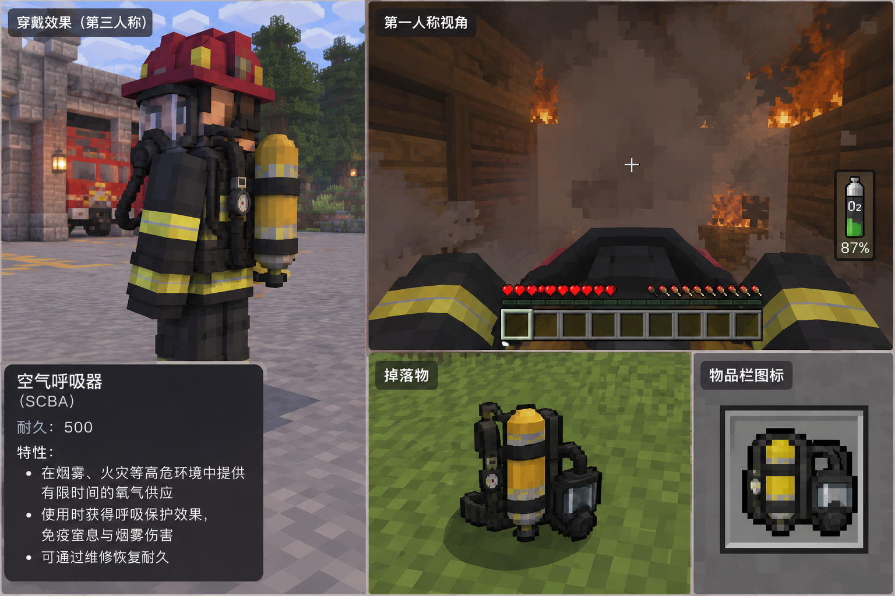
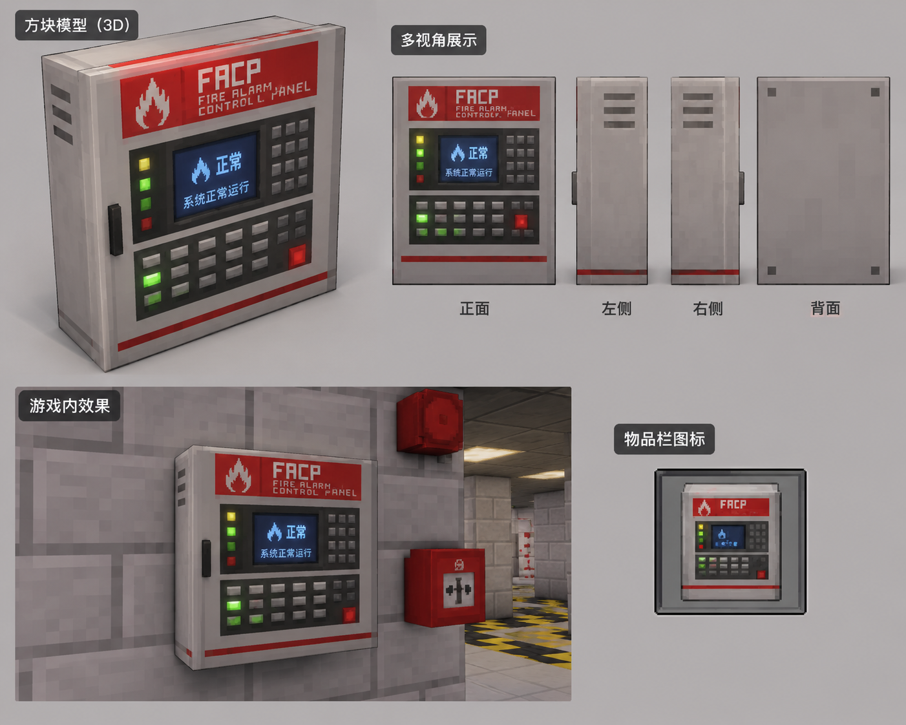
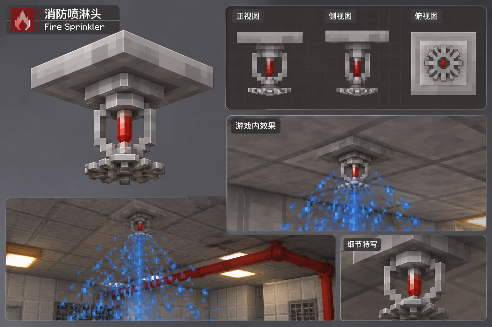
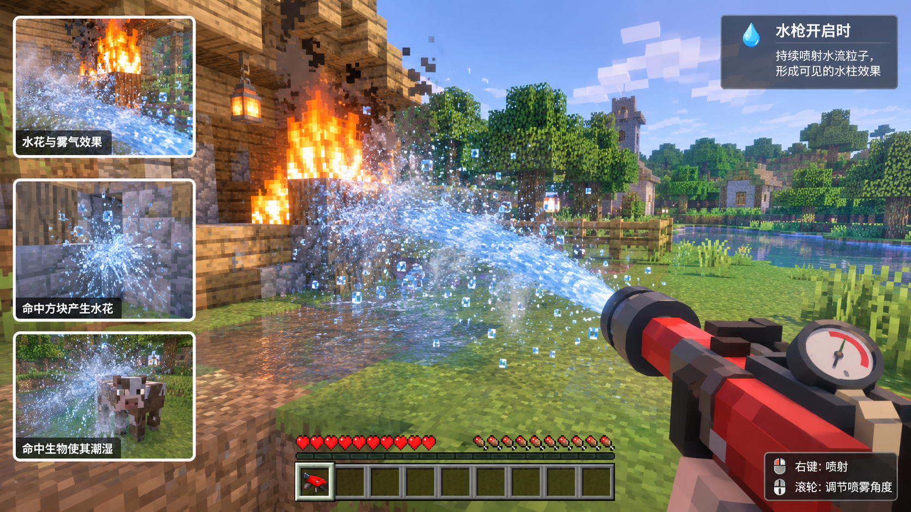

# BlockFireRescue（方块消防）  

>[!WARNING]
>本项目由Java初学者借助AI编写，可能存在错误  

## 项目简介
这是一个有关消防救援的大型Minecraft模组，目前正处于早期开发阶段。

## 模组内容
以消防救援为主题，涵盖**防护装备**、**灭火装备**、**建筑物消防系统**、**消防车**等内容，**重写原版的火焰蔓延机制**，并加入**烟气系统**。  
预计会与[`Create（机械动力）`](https://github.com/Creators-of-Create/Create)等支持流体管路的工业模组还有急救类模组展开联动。    

## 技术信息  
* 支持版本：`Minecraft_JavaEdition-1.21.11`  
* 模组加载器：`Neoforge`
* 构建系统：`Gradle`

## 预计支持的功能（todolist）
- [ ] 全套消防服
- [ ] 消防破拆工具套装
- [ ] 空气呼吸器SCBA
- [ ] 火焰蔓延系统重写
- [ ] 烟气系统
- [ ] 水带泵浦系统
- [ ] 原版方块变种（潮湿、破碎、灰烬）
- [ ] 室内消防系统
- [ ] 各种消防车辆
- [ ] 和Create（机械动力）的流体管路系统联动
- [ ] 和急救类模组联动
- [ ] 更多的正面和负面buff
- [ ] 其他的一些内容

## 游玩安装
1.下载Release中的发布版本  
2.下载GitHub Actions中的自动构建产物  
3.~~下载MC百科/Modrinth/Curseforge等平台的发布版本~~（暂未上传）

## 许可证
Apache-2.0 License

## GPT生成的一些开发效果图（仅供参考）
  
  

